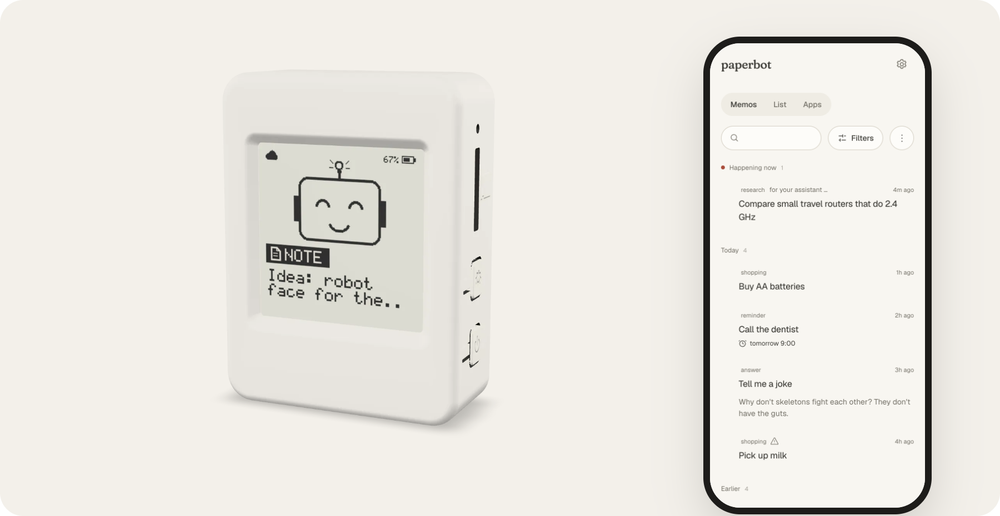
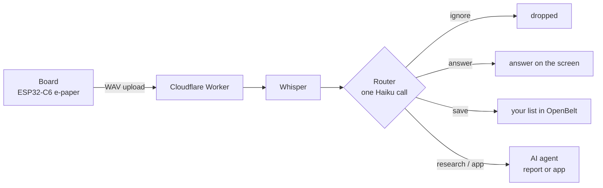
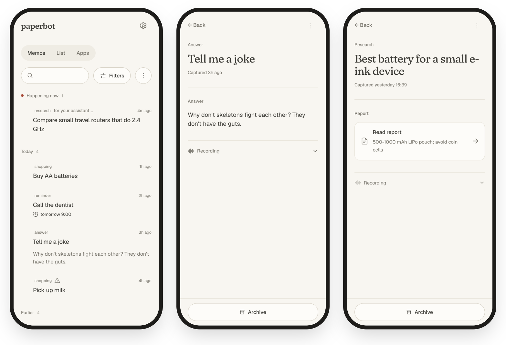

# paperbot

A push-to-talk voice memo gadget with an e-paper face. Hold ☀, talk, let go. paperbot transcribes the clip
and decides what it is: a question it answers on the screen, something to remember, or a job for an AI agent.



[paperbot.ca](https://paperbot.ca) · [app.paperbot.ca](https://app.paperbot.ca) · [set up a board](https://app.paperbot.ca/setup)

## How it works



- **The board** is a Waveshare ESP32-C6 1.54" e-paper board (200×200, 1-bit) with a robot face, Bolt. It sleeps
  until you hold ☀, uploads the clip, and shows the result when it is ready.
- **The router** reads the memo with its context (time, place, the memos just before it, your open items) and picks
  one action: **ignore**, **answer**, **save**, **research** or **app**.
- **Saved items** (todos, shopping, reminders, notes) live in your own [OpenBelt](https://openbelt.com) workspace.
- **Research and apps** go to an agent with a fixed budget. It writes a report, or builds an app on OpenBelt.
  You can also let your own assistant (Claude Code, claude.ai, ChatGPT) pick up research over MCP.

## The web app

Memos, your list and your apps, on any phone or computer.

<picture>
  <source media="(prefers-color-scheme: dark)" srcset="docs/screens/app-dark.png">
  
</picture>

## Set up a board

Plug the board into a computer with USB and open **[app.paperbot.ca/setup](https://app.paperbot.ca/setup)** in
Chrome, Edge or Firefox. The page installs the firmware, signs you in and connects the board to Wi-Fi (Web Serial,
no install). More in [docs/setup.md](docs/setup.md).

## Development

```sh
git clone --recurse-submodules https://github.com/mrjoedang/paperbot.git && cd paperbot
brew install arduino-cli && arduino-cli core install esp32:esp32@3.3.0
(cd server && npm ci && npm run types)
make sim           # the firmware in a browser simulator, no hardware needed
```

| Command | What it does |
|---|---|
| `make help` | every target |
| `make sim-test` | all simulator scenarios, headless → `build/sim-test/report.html` |
| `make firmware` / `make flash` | build the board firmware / build and flash it over USB |
| `make logs` | the board's serial log |
| `sh tools/local-worker.sh` | the Worker on `127.0.0.1:8787` (no AI binding) |
| `make shots` | screenshots of every web screen, light and dark, desktop and phone |
| `make deploy-dev` / `make deploy` | deploy the Worker to dev / production |
| `make release VERSION=x.y.z` | a signed OTA image ([docs/device-api.md](docs/device-api.md) §6) |

Change device logic in `firmware/core`, prove it in the simulator, then flash. Board not showing up on USB? See
[docs/hardware.md](docs/hardware.md#recovery-board-not-showing-up-on-usb).

Secrets are not in git (all gitignored):

| File | Holds |
|---|---|
| `.secrets.env` | `DEVICE_TOKEN` (owner board and `/admin`), `PAPERBOT_WIFI_KEY`, `OWNER_EMAIL` |
| `.secrets/ota_signing_key.pem` | the OTA signing key (`sh tools/ota/keygen.sh`). Lose it and boards need a USB reflash. |
| `firmware/paperbot/secrets.h` | a development board's Wi-Fi, server and token (copy `secrets.example.h`) |
| `server/.dev.vars`, `server/.secrets` | the local and dev Worker's secrets |

## Layout

```
firmware/core/      device logic shared by the board and the simulator: state machine, upload queue, results, OTA,
                    Wi-Fi, setup over serial, the Bolt UI
firmware/paperbot/  the board: ESP32 hardware layer, display and audio drivers
sim/                the simulator: firmware/core on your computer with fake hardware, browser UI, mock server, scenarios
server/             Cloudflare Worker: device API (/v1), pipeline (Whisper, router), agents, accounts, MCP, web app (public/)
site/               paperbot.ca
tools/              serial tools, OTA signing, release image, end-to-end and screenshot scripts
docs/               device API, setup, hardware notes, decisions
vendor/waveshare    git submodule: Waveshare's board repo (LVGL, examples, schematic)
```

[docs/decisions.md](docs/decisions.md) explains why things are the way they are, with the evidence.

## History

Started 2026-10-17. The history before this repo went public is in a private archive.

## License

[MIT](LICENSE)
