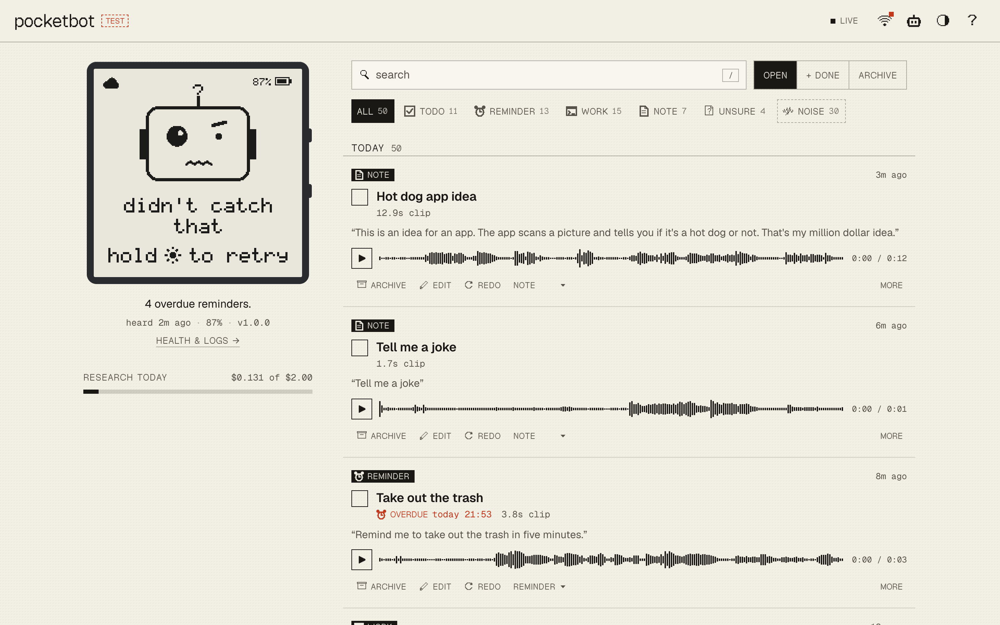

# paperbot

A pocket push-to-talk voice capture gadget. Hold ☀, talk, let go: the clip goes to
your own Cloudflare Worker, gets transcribed, and one model call decides what to do with it: **ignore** it,
**answer** it on the screen, **save** it to your list (todos, shopping, reminders, notes, kept in your OpenBelt
workspace), **research** it or build an **app**. Research and apps are done by an AI agent. Fully hands-off.

- **Device:** Waveshare ESP32-C6 1.54" e-Paper board (200×200 1-bit), "Bolt" robot UI.
- **Server + web app:** https://app.paperbot.ca (Cloudflare Worker).



## Layout

```
firmware/
  paperbot/     board sketch: ESP32 hardware layer (esp32_hal.*), display/codec drivers, secrets.h
  core/          device logic shared by board + simulator (state machine, queue, results, OTA,
                 status reports, Wi-Fi places, Bolt UI)
  lvgl_conf/     LVGL config
  build.sh       compile (and flash)
sim/             simulator: runs firmware/core natively with fake hardware, browser UI,
                 mock server, headless scenarios
server/          Cloudflare Worker (paperbot): device API, pipeline (Whisper → Clef/Qwen),
                 research agents (Pi), web app (public/)
  legacy-shim/   shims at the old workers.dev URLs: forward /v1 to paperbot
tools/           serial tools (bootlog, devcmd, devsoak), ota/ (keygen, release), setup-bundle.sh (release image)
docs/            device-api.md (device ↔ server contract), setup.md (setup in the browser, accounts), hardware.md (board notes, recovery),
                 decisions.md (why things are the way they are)
design/          UI concept pages
vendor/waveshare git submodule: Waveshare's official repo (LVGL library, examples, schematic)
```

## Setting up a board (for anyone with the hardware)

Plug the board into a computer by USB and open **https://app.paperbot.ca/setup** in Chrome, Edge or Firefox: it
installs the firmware, signs you in and connects the board to Wi-Fi, all in the page (Web Serial).

See [docs/setup.md](docs/setup.md) (accounts, research with your own Claude, release image).

## Development setup (once per machine)

```sh
git clone --recurse-submodules git@github.com:mrjoedang/paperbot.git && cd paperbot
brew install arduino-cli && arduino-cli core install esp32:esp32@3.3.0
(cd server && npm ci && npm run types)
```

Secrets are **not** in git. Restore them from your password manager:

| File | Contains |
|---|---|
| `.secrets.env` | `DEVICE_TOKEN` (device ↔ server), `PAPERBOT_WIFI_KEY`, `OWNER_EMAIL` (the owner's Google address; a Worker secret) |
| `.secrets/ota_signing_key.pem` | OTA signing key — **if lost, devices need a USB reflash** |
| `firmware/paperbot/secrets.h` | Wi-Fi fallback + `SERVER_URL` + `DEVICE_TOKEN` (copy `secrets.example.h`) |
| `server/.dev.vars`, `server/.secrets` | dev Worker token / keys |

## Everyday tasks

```sh
make help          # all targets
make sim           # simulator in the browser (no hardware needed)
make sim-test      # all scenarios headless -> build/sim-test/report.html
make firmware      # compile the board firmware
make flash         # compile + flash over USB (board must be plugged in and awake)
make logs          # board serial log
make deploy        # server + web app -> production
make release VERSION=1.0.1   # signed OTA image (publishing: docs/device-api.md §6)
```

Change the device logic in `firmware/core`, prove it in the simulator (`make sim-test`), then
`make flash`. Server/web changes: `make deploy-dev`, `make e2e`, check, `make deploy`.

Board won't show up on USB? See **docs/hardware.md → Recovery**.

## History

Started 2026-10-17. The history before this repo went public (commits and PRs #1-34) is in the private
`mrjoedang/paperbot-history`. The design rationale and test evidence are in `docs/decisions.md`.

## License

[MIT](LICENSE)
